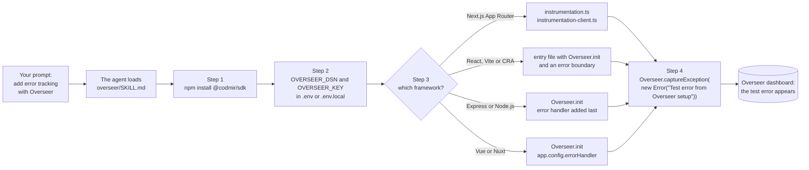

<p align="center">
  <picture>
    <source media="(prefers-color-scheme: dark)" srcset="docs/assets/hero-dark.svg">
    <source media="(prefers-color-scheme: light)" srcset="docs/assets/hero-light.svg">
    
  </picture>
</p>

<p align="center">
  <a href="LICENSE"></a>
  <a href="#skills"></a>
  <a href="#contributing"></a>
</p>

<p align="center">
  <a href="#claude-code"></a>
  <a href="#cursor"></a>
  <a href="#github-copilot"></a>
  <a href="#windsurf"></a>
</p>

<p align="center">
  <a href="#skills"><b>Skills</b></a> ·
  <a href="#install-it-in-your-agent"><b>Install</b></a> ·
  <a href="#examples"><b>Examples</b></a> ·
  <a href="#how-it-works"><b>How it works</b></a> ·
  <a href="#check-before-you-run-it"><b>Check before you run it</b></a> ·
  <a href="#troubleshooting"><b>Troubleshooting</b></a> ·
  <a href="#faq"><b>FAQ</b></a> ·
  <a href="#contributing"><b>Contributing</b></a> ·
  <a href="https://codmir.com"><b>codmir.com</b></a>
</p>

AI skills for coding agents, from [Codmir](https://codmir.com). A skill is a folder with a `SKILL.md` file of
instructions that an agent reads when you ask for the task it covers. This repository has one skill,
[`overseer`](overseer/SKILL.md): it tells an agent how to add [`@codmir/sdk`](https://github.com/codmir-labs/sdk) error
tracking to an app.

The fastest route installs nothing. Paste this into your coding agent:

```text
Install the Overseer AI skill from github.com/codmir-labs/skills and use it to add error tracking to this application with Overseer following best practices.
```

That prompt relies on the agent being able to read this repository, so it needs web access or a shell with network
access; see [Any other agent: the prompt route](#any-other-agent-the-prompt-route). To have the agent load the skill
itself, follow [Install it in your agent](#install-it-in-your-agent).

> [!NOTE]
> Checked on 2026-11-23 against `overseer/SKILL.md` at commit
> [`fa0639b`](https://github.com/codmir-labs/skills/commit/fa0639b), `@codmir/sdk` 2.0.1 (the latest release on npm that
> day, installed from its tarball) and each agent's documentation, linked where it is used. Two things to know before you
> run the skill. `SKILL.md` has no frontmatter, which changes how each agent loads it
> ([Install it in your agent](#install-it-in-your-agent)). And some of the code it tells the agent to write does not run
> on 2.0.1 ([Check before you run it](#check-before-you-run-it)).

<details>
<summary><b>Contents</b></summary>

- [Skills](#skills): [overseer, step by step](#overseer-what-it-makes-the-agent-do)
- [Install it in your agent](#install-it-in-your-agent): [one command for every agent](#one-command-for-every-agent), [Claude Code](#claude-code), [Cursor](#cursor), [GitHub Copilot](#github-copilot), [Windsurf](#windsurf), [any other agent](#any-other-agent-the-prompt-route), [rules instead of skills](#if-your-agent-has-no-skills)
- [Examples](#examples)
- [How it works](#how-it-works)
- [Check before you run it](#check-before-you-run-it)
- [Troubleshooting](#troubleshooting)
- [FAQ](#faq)
- [Repository layout](#repository-layout)
- [Contributing](#contributing)
- [License](#license)

</details>

## Skills

| Skill | What it makes the agent do | Files |
| --- | --- | --- |
| [`overseer`](overseer/) | Add `@codmir/sdk` error tracking to an app: install the package, set a DSN and a key, initialise the SDK for Next.js, React, Express or Vue, and send a test error | [`SKILL.md`](overseer/SKILL.md), [`README.md`](overseer/README.md) |

### overseer: what it makes the agent do

Four steps, in the order [`SKILL.md`](overseer/SKILL.md) gives them:

<table>
<tr>
<td width="25%" valign="top">
<br>
<b>1. Install the SDK</b><br>
Runs <code>npm install @codmir/sdk</code> (<a href="overseer/SKILL.md#L5-L9">lines 5 to 9</a>).
</td>
<td width="25%" valign="top">
<br>
<b>2. Set two variables</b><br>
Adds <code>OVERSEER_DSN</code> and <code>OVERSEER_KEY</code> to <code>.env</code> or <code>.env.local</code>, from your project's Overseer setup page (<a href="overseer/SKILL.md#L11-L20">lines 11 to 20</a>).
</td>
<td width="25%" valign="top">
<br>
<b>3. Initialise the SDK</b><br>
Calls <code>Overseer.init</code> with your DSN, using the section for your framework: Next.js, React, Express or Vue (<a href="overseer/SKILL.md#L22-L122">lines 22 to 122</a>).
</td>
<td width="25%" valign="top">
<br>
<b>4. Verify</b><br>
Sends <code>Overseer.captureException(new Error("Test error from Overseer setup"))</code> and has you look for it in the Overseer dashboard (<a href="overseer/SKILL.md#L124-L130">lines 124 to 130</a>).
</td>
</tr>
</table>

Step 3 has one section per framework:

| Framework | What the skill has the agent edit | Lines |
| --- | --- | --- |
| Next.js (App Router) | `instrumentation.ts` for the server and `instrumentation-client.ts` for the browser | [24 to 53](overseer/SKILL.md#L24-L53) |
| React (Vite or CRA) | The entry file, `main.tsx` or `index.tsx`, and an error boundary around the app | [55 to 84](overseer/SKILL.md#L55-L84) |
| Express or Node.js | `Overseer.init` before the routes, and an error handler added last | [86 to 103](overseer/SKILL.md#L86-L103) |
| Vue or Nuxt | `Overseer.init`, and `app.config.errorHandler` set to call `Overseer.captureException` | [105 to 122](overseer/SKILL.md#L105-L122) |

It ends with five best practices (set `environment`, set `release`, call `Overseer.setUser` after sign-in, turn replay
on only in production, upload source maps) and an options reference
([lines 132 to 155](overseer/SKILL.md#L132-L155)).

> [!WARNING]
> `SKILL.md` was written for an API that `@codmir/sdk` 2.0.1, the version `npm install @codmir/sdk` installed on
> 2026-11-23, does not have: two of its imports and one function it calls are missing, and the replay options it sets
> are ignored. Read [Check before you run it](#check-before-you-run-it) before you let an agent run it.

## Install it in your agent

`overseer/` is a skill folder in the shape the [Agent Skills](https://agentskills.io/specification) standard describes:
a directory named after the skill, holding a `SKILL.md`. Claude Code, Cursor, GitHub Copilot and Windsurf all load skills
from a folder like that. They differ in where the folder goes, and in what the frontmatter must say.

> [!IMPORTANT]
> `overseer/SKILL.md` starts with `# Overseer — Error Tracking & Session Replay`, not with a frontmatter block (the
> `name` and `description` between two `---` lines). The standard requires both fields. The Agent Skills reference
> validator, `skills-ref` 0.1.1, rejects the folder as it is: `SKILL.md must start with YAML frontmatter (---)`.

What each agent's documentation says about a skill file that has no frontmatter:

| Agent | `overseer/` as it is in this repository | Closest working way |
| --- | --- | --- |
| [Claude Code](#claude-code) | Loads: every frontmatter field is optional. `name` defaults to the folder name and `description` to the first non-empty line of the file, here the `# Overseer — ...` heading | Add a `description` so Claude knows when to use it |
| [Cursor](#cursor) | Not as it is: the docs list `name` and `description` as required | Add both |
| [GitHub Copilot](#github-copilot) | Not as it is: the docs list `name` and `description` as required | Add both |
| [Windsurf](#windsurf) | Loads: frontmatter is optional. `name` defaults to the folder name, and `description` has no default | Add a `description` |

### One command for every agent

Where the folder goes:

| Agent | In one project | For all your projects |
| --- | --- | --- |
| Claude Code | `.claude/skills/overseer/` | `~/.claude/skills/overseer/` |
| Cursor | `.cursor/skills/overseer/` | `~/.cursor/skills/overseer/` |
| GitHub Copilot | `.github/skills/overseer/` | `~/.copilot/skills/overseer/` |
| Windsurf | `.devin/skills/overseer/` | `~/.config/devin/skills/overseer/` |

From your project's root, on macOS, Linux, WSL or Git Bash, set `DEST` to your agent's project folder and run this. It
writes the frontmatter all four agents accept, then the contents of `overseer/SKILL.md`:

<!-- snippet: install -->
```bash
DEST=.claude/skills/overseer   # your agent's project folder from the table above
body=$(curl -fsSL https://raw.githubusercontent.com/codmir-labs/skills/main/overseer/SKILL.md) &&
  mkdir -p "$DEST" &&
  cat > "$DEST/SKILL.md" <<EOF
---
name: overseer
description: Adds Codmir Overseer error tracking to an app with @codmir/sdk. Installs the package, sets the DSN and key, initialises the SDK for Next.js, React, Express or Vue, and sends a test error. Use when asked to add error tracking, error monitoring or Overseer to an application.
---

$body
EOF
```

`name` matches the folder name, which Cursor, GitHub Copilot in VS Code and the standard require. The frontmatter has to
be the first thing in the file: Claude Code reads it only when the first line is `---`. If `curl` fails, the rest of the
command does not run and nothing is written.

> [!WARNING]
> A skill is instructions an agent follows. GitHub's Copilot documentation warns that skills are not verified and may
> contain prompt injections or malicious scripts, and advises reading one before you install it. Read
> [`overseer/SKILL.md`](overseer/SKILL.md) first; it is 155 lines.

One copy can serve several agents. Cursor, GitHub Copilot and Windsurf all read `.agents/skills/`, so a team that uses
more than one of them can keep `.agents/skills/overseer/` instead. Claude Code reads `.claude/skills/`, which Cursor and
GitHub Copilot also read.

### Claude Code

Documentation: [Extend Claude with skills](https://code.claude.com/docs/en/skills).

- Put the folder in `.claude/skills/overseer/` and commit it to share it with everyone who works in the repository, or in
  `~/.claude/skills/overseer/` for all your projects.
- Claude Code watches these folders, so a new skill is picked up in the current session. If it does not appear, run
  `/reload-skills`. To see what is loaded, ask `What skills are available?`.
- Run it with `/overseer`, or ask for the task and let Claude match your request to the skill's description. Text you
  type after `/overseer` reaches Claude as `ARGUMENTS: <your input>` at the end of the skill, because `SKILL.md` has no
  `$ARGUMENTS` placeholder.

### Cursor

Documentation: [Agent Skills](https://cursor.com/docs/skills), [Rules](https://cursor.com/docs/rules).

- Put the folder in `.cursor/skills/overseer/` for one project, or `~/.cursor/skills/overseer/` for all of them. Cursor also
  loads `.agents/skills/` and, for compatibility, `.claude/skills/`.
- `name` must match the folder name, and `description` is what the agent uses to decide when the skill is relevant.
- Type `/` in Agent chat and choose `overseer` to run it; a skill run this way attaches to one message. Open
  **Customize** in the sidebar and go to **Skills** to see what Cursor found.

### GitHub Copilot

Documentation: [Adding agent skills for GitHub Copilot](https://docs.github.com/en/copilot/how-tos/copilot-on-github/customize-copilot/customize-cloud-agent/add-skills),
[Agent skills](https://docs.github.com/en/copilot/concepts/customizations/agent-skills) and, for VS Code,
[Use Agent Skills in VS Code](https://code.visualstudio.com/docs/agent-customization/agent-skills).

- Put the folder in `.github/skills/overseer/` for one repository (Copilot also reads `.claude/skills/` and
  `.agents/skills/`), or `~/.copilot/skills/overseer/` for all of them (`~/.agents/skills/` works too).
- `name` and `description` are required. The file must be called `SKILL.md`, and the folder name lowercase with hyphens.
- Copilot decides when to use a skill from your prompt and the skill's description. In VS Code, type `/` in chat to run
  one by name.
- Skills work in the GitHub Copilot app, the Copilot CLI, Copilot cloud agent and code review on GitHub.com, and agent
  mode in Visual Studio Code, Visual Studio and JetBrains IDEs; the documentation says IDE support depends on your
  version.
- Do not put the procedure in `.github/copilot-instructions.md`. Repository-wide instructions apply to every request in
  the repository, and the documentation recommends skills for detailed instructions Copilot should read only when relevant.

### Windsurf

Windsurf is now Devin Desktop (its documentation announces the rename for 2 June 2026) and lives at docs.devin.ai.
It shares its agent harness with Devin CLI, so its skills use the CLI's format. See
[Devin Local customizations](https://docs.devin.ai/desktop/devin-local/customizations), the CLI's
[Skills overview](https://docs.devin.ai/cli/extensibility/skills/overview) and
[Creating skills](https://docs.devin.ai/cli/extensibility/skills/creating-skills), and the
[Devin Desktop FAQ](https://docs.devin.ai/desktop/devin-desktop-faq).

- Put the folder in `.devin/skills/overseer/` for one workspace (`.agents/skills/` and the legacy `.windsurf/skills/` are
  also read), or `~/.config/devin/skills/overseer/` for all of them (`~/.agents/skills/` is also read).
- Frontmatter is optional here. The Creating skills page gives `name` the folder name as its default and `description` no
  default; the description is what the agent is shown to decide whether to run the skill.
- Run it with `/overseer`, or let the agent run it when your request matches the description. The **Customize** page in
  the agent sidebar lists the skills that are loaded.

### Any other agent: the prompt route

The prompt at the top of this page is the route this repository's earlier README gave, and the Overseer documentation at
[codmir.com/docs/overseer](https://codmir.com/docs/overseer) shows the same prompt. It does not install a skill. It
relies on three things:

- the agent can open `github.com/codmir-labs/skills`, through a web tool or a shell with network access;
- it finds `overseer/SKILL.md` in the repository on its own;
- it follows whatever `main` holds at that moment.

If your agent has no web access, or you want to pin what it reads, use the install command above. To give the agent the
file directly, point it at the raw file:

```text
Read https://raw.githubusercontent.com/codmir-labs/skills/main/overseer/SKILL.md and follow it to add error tracking to this application with Overseer.
```

### If your agent has no skills

If your version of Cursor, GitHub Copilot or Windsurf has no skills, a rule file or an instructions file can carry the
same text.

<details>
<summary><b>Rule files and custom instructions</b></summary>

Write the file as the command above does: the frontmatter from the table, then the contents of `overseer/SKILL.md`.

| Agent | File | Frontmatter | What it does |
| --- | --- | --- | --- |
| Cursor | `.cursor/rules/overseer.mdc` | `description` as above, and `alwaysApply: false` | The agent reads the description and pulls the rule in when relevant. The extension must be `.mdc`: a plain `.md` file in `.cursor/rules` is ignored |
| Windsurf | `.devin/rules/overseer.md`, or the legacy `.windsurf/rules/overseer.md` | `trigger: model_decision` and `description` as above | The rule reaches the agent when it decides the description is relevant |
| GitHub Copilot | `.github/copilot-instructions.md` | none | Applies to every request in the repository, not on demand. For a one-off setup, use the prompt route instead |

For example, the Cursor rule starts like this:

```markdown
---
description: Adds Codmir Overseer error tracking to an app with @codmir/sdk. Installs the package, sets the DSN and key, initialises the SDK for Next.js, React, Express or Vue, and sends a test error. Use when asked to add error tracking, error monitoring or Overseer to an application.
alwaysApply: false
---

# Overseer — Error Tracking & Session Replay
```

Documentation: [Cursor rules](https://cursor.com/docs/rules), [Devin CLI rules](https://docs.devin.ai/cli/extensibility/rules),
[GitHub Copilot repository instructions](https://docs.github.com/en/copilot/how-tos/copilot-on-github/customize-copilot/add-custom-instructions/add-repository-instructions).

</details>

## Examples

One example per agent. Each shows the files you create and the prompt you type. The agent's own output is not shown:
it varies from run to run, and what it writes has to be checked against
[Check before you run it](#check-before-you-run-it).

<details open>
<summary><b>Claude Code, in a Next.js App Router app</b></summary>

Run the [install command](#one-command-for-every-agent) with `DEST=.claude/skills/overseer`. You now have:

```text
my-next-app/
└── .claude/
    └── skills/
        └── overseer/
            └── SKILL.md
```

`SKILL.md` starts with the frontmatter, then the repository's file:

```markdown
---
name: overseer
description: Adds Codmir Overseer error tracking to an app with @codmir/sdk. Installs the package, sets the DSN and key, ...
---

# Overseer — Error Tracking & Session Replay

You are integrating Codmir Overseer into this application. ...
```

Start `claude` in `my-next-app` and type:

```text
/overseer This is a Next.js App Router app. Add error tracking.
```

For Next.js, `SKILL.md` then has Claude install `@codmir/sdk`, put `OVERSEER_DSN` and `OVERSEER_KEY` in `.env` or `.env.local`,
create or update `instrumentation.ts` and `instrumentation-client.ts`, and send the test error. The two values come from
your project's Overseer setup page, so have them ready.

</details>

<details>
<summary><b>Cursor, in a React and Vite app</b></summary>

Run the [install command](#one-command-for-every-agent) with `DEST=.cursor/skills/overseer`. You now have:

```text
my-vite-app/
└── .cursor/
    └── skills/
        └── overseer/
            └── SKILL.md
```

In Agent chat, type `/`, choose `overseer`, and finish the message:

```text
Add error tracking to this React and Vite app.
```

For React, `SKILL.md` has Cursor call `Overseer.init` in the entry file with `import.meta.env.VITE_OVERSEER_DSN`, and
wrap the app in an error boundary.

</details>

<details>
<summary><b>GitHub Copilot, in an Express API</b></summary>

Run the [install command](#one-command-for-every-agent) with `DEST=.github/skills/overseer`. You now have:

```text
my-api/
└── .github/
    └── skills/
        └── overseer/
            └── SKILL.md
```

In VS Code, in Copilot Chat's agent mode, type:

```text
Add error tracking to this Express app with Overseer.
```

Copilot matches the prompt to the skill's description. For Express, `SKILL.md` has it call `Overseer.init` before the
routes and add the error handler last, under the comment `Error handler — must be last`.

</details>

<details>
<summary><b>Windsurf, in a Vue app</b></summary>

Run the [install command](#one-command-for-every-agent) with `DEST=.devin/skills/overseer`. You now have:

```text
my-vue-app/
└── .devin/
    └── skills/
        └── overseer/
            └── SKILL.md
```

In the agent chat, type:

```text
/overseer This is a Vue app. Add error tracking.
```

For Vue, `SKILL.md` has the agent call `Overseer.init` and set `app.config.errorHandler` to pass each error to
`Overseer.captureException`.

</details>

## How it works

The flowchart uses only the steps `SKILL.md` gives. Everything before step 1 is your agent loading the skill; everything
after step 4 is Overseer.



## Check before you run it

On 2026-11-23, `npm install @codmir/sdk` installed 2.0.1, the latest release on npm. `SKILL.md` was written for an API
that 2.0.1 does not have. Each row below was run against the installed package, not only read.

| `SKILL.md` tells the agent to | `@codmir/sdk` 2.0.1 | Source |
| --- | --- | --- |
| `import { Overseer } from "@codmir/sdk/browser"` ([43](overseer/SKILL.md#L43), [60](overseer/SKILL.md#L60), [108](overseer/SKILL.md#L108)) | The browser entry has no `Overseer` export, only `addBreadcrumb`, `captureException`, `captureMessage`, `close`, `flush`, `getClient`, `init`, `isOverseerInitialized`, `setTags` and `setUser`. Node stops at the import with `does not provide an export named 'Overseer'`, and esbuild reports `No matching export`. `import * as Overseer from "@codmir/sdk/browser"` gives the same calls something to resolve to | `dist/browser/index.js:176-187` |
| `import { OverseerErrorBoundary } from "@codmir/sdk/react"` ([75](overseer/SKILL.md#L75)) | The package has no `./react` entry, so Node refuses the import with `ERR_PACKAGE_PATH_NOT_EXPORTED`. The only error boundary in it is `createErrorBoundary` in `@codmir/sdk/react-native` | `package.json` `exports`, `dist/react-native/index.js:82` |
| `app.use(Overseer.expressErrorHandler())` ([102](overseer/SKILL.md#L102)) | `Overseer` has no such member. The Express middleware is `errorHandler()` from `@codmir/sdk/express`, which captures the error and calls `next(err)` | `dist/chunk-6CRI34ER.js:22-44`, `dist/express/index.js:70-109` |
| `replay: { enabled: true, bufferSeconds: 15 }` ([48](overseer/SKILL.md#L48), [65](overseer/SKILL.md#L65), [113](overseer/SKILL.md#L113), [147](overseer/SKILL.md#L147)) and "15-second DVR session replay" ([3](overseer/SKILL.md#L3)) | `init` has no `replay` option: the client builds its settings from fixed keys and drops the rest, and the package has no `bufferSeconds` and no 15-second buffer. `@codmir/sdk/replay` is a separate recorder, `ReplayRecorder`, with 5-minute segments that you start yourself | `dist/chunk-6CRI34ER.js:1147-1164`, `dist/replay/index.js:12-18` |
| `tracesSampleRate` default `0.1` ([152](overseer/SKILL.md#L152)) | The default is `0`, and nothing else in the package reads it, so setting it changes nothing | `dist/chunk-6CRI34ER.js:1157` |
| `OVERSEER_KEY` ([17](overseer/SKILL.md#L17)) | No code in `SKILL.md` passes it to `init`. The SDK sends a key, as the `x-overseer-key` header, only when `init` gets `clientKey` or `overseerKey`, and the Overseer client reads no environment variable | `dist/chunk-6CRI34ER.js:1145`, `:1339-1345` |
| Every `.ts` snippet | The package ships no `.d.ts` files although `types` points at `./dist/index.d.ts`, so a project with `strict` on fails `tsc` with `TS7016: Could not find a declaration file for module '@codmir/sdk'` | `package.json:8`, `tsc` 5.9.3 run |

What does run on 2.0.1: `npm install @codmir/sdk`; `import { Overseer } from "@codmir/sdk"` with
`Overseer.init({ dsn, environment, release })`; `Overseer.captureException`; `Overseer.setUser`; `sampleRate`, which
defaults to 1; and `beforeSend`.

The SDK's `main` branch (commit `a0715d9`, version 2.2.0 in its `package.json`) is ahead of 2.0.1 and unreleased. It
adds `startReplay()` to `@codmir/sdk/replay`, but it also has no `./react` entry, no `expressErrorHandler` and no
`bufferSeconds`.

## Troubleshooting

<details>
<summary><b>The agent does not use the skill on its own</b></summary>

Without a `description` the agent has little to match your request against. Cursor's documentation says an agent is
unlikely to pick a skill that has none, but that you can still run it by name. Add the frontmatter from
[the install command](#one-command-for-every-agent), or run the skill with `/overseer`.

</details>

<details>
<summary><b>/overseer does not show up</b></summary>

Check that the folder is called `overseer`, holds a file called exactly `SKILL.md`, and that the frontmatter `name` equals
the folder name: Cursor and GitHub Copilot require them to match. In Claude Code run `/reload-skills`, and ask
`What skills are available?`. In Cursor look under **Customize**, then **Skills**.

</details>

<details>
<summary><b>Cursor ignores my rule file</b></summary>

Project rules must end in `.mdc`. A plain `.md` file in `.cursor/rules` is ignored, because it has no frontmatter to say
when it applies.

</details>

<details>
<summary><b>The build fails on an import from @codmir/sdk</b></summary>

`does not provide an export named 'Overseer'`, `ERR_PACKAGE_PATH_NOT_EXPORTED` for `@codmir/sdk/react`, and `TS7016` for
the missing type declarations are all described in [Check before you run it](#check-before-you-run-it).

</details>

<details>
<summary><b>The test error never shows up in the dashboard</b></summary>

On 2.0.1, `captureException` queues the event and sends it one second after the last capture. A Node script that ends
normally still sends it, because the timer keeps the process alive; one that calls `process.exit()` first loses it, so
`await Overseer.flush()` before it exits. With neither a `dsn` nor a key, the SDK sends nothing and says nothing unless
you set `debug: true`, which logs `[Overseer] No DSN configured, events:`.

</details>

## FAQ

<details>
<summary><b>Do I need a Codmir project?</b></summary>

`SKILL.md` takes the DSN and the key from your project's Overseer setup page on codmir.com
([line 20](overseer/SKILL.md#L20)), so have a project with Overseer set up, and both values, before you start.

</details>

<details>
<summary><b>What is the difference between a skill and a rule?</b></summary>

Devin's documentation puts it this way: rules tell the agent how to behave and are always on, or switched on by a
trigger; skills are multi-step procedures with supporting files, run by the model when relevant or by you. GitHub's
documentation recommends custom instructions for what applies to almost every task, and skills for detailed
instructions Copilot should read only when relevant. `overseer` is a one-off setup procedure, so it is a skill.

</details>

<details>
<summary><b>Which version of the SDK does the skill install?</b></summary>

`npm install @codmir/sdk` installs the latest release, which was 2.0.1 on 2026-11-23. Check yours with
`npm view @codmir/sdk version`.

</details>

<details>
<summary><b>Is Windsurf the same as Devin Desktop?</b></summary>

Yes. Its documentation says Devin Desktop is the new name for Windsurf, announced for 2 June 2026, with the same editor and
features, and that it keeps reading Windsurf rules. This page keeps the name Windsurf so that you can find it.

</details>

<details>
<summary><b>Can I use one folder for several agents?</b></summary>

Yes. See the end of [One command for every agent](#one-command-for-every-agent): `.agents/skills/` for Cursor, GitHub
Copilot and Windsurf, `.claude/skills/` for Claude Code, Cursor and GitHub Copilot.

</details>

<details>
<summary><b>Where do I report a problem or ask for a skill?</b></summary>

In [GitHub Issues](https://github.com/codmir-labs/skills/issues).

</details>

## Repository layout

| Path | What it holds |
| --- | --- |
| [`overseer/SKILL.md`](overseer/SKILL.md) | The skill: 155 lines, no frontmatter |
| [`overseer/README.md`](overseer/README.md) | A short page for the folder: the prompt, what the skill does, a link to the Overseer documentation |
| [`docs/assets/`](docs/assets) | This page's hero and icons |
| [`LICENSE`](LICENSE) | MIT License, Copyright (c) 2026 Codmir Labs |
| [`README.md`](README.md) | This page |

## Contributing

A skill is one folder at the root of the repository, named after the skill:

```text
my-skill/
├── SKILL.md        required: frontmatter with name and description, then the instructions
├── README.md       optional here: a short page for people reading the folder on GitHub
├── scripts/        optional: code the agent can run
├── references/     optional: longer documents the agent reads when it needs them
└── assets/         optional: templates and other files the skill uses
```

The [Agent Skills specification](https://agentskills.io/specification) sets the rules every agent above builds on:

- `name`: 1 to 64 characters, lowercase letters, numbers and hyphens, not starting or ending with a hyphen, no two hyphens
  in a row, and equal to the folder name.
- `description`: 1 to 1,024 characters, saying what the skill does and when to use it.
- Keep `SKILL.md` under 500 lines and move longer material into `references/`.

Then add a row to the [Skills table](#skills), and validate the folder with `skills-ref`, the reference library the
specification points to:

```bash
pip install skills-ref
agentskills validate my-skill
```

`overseer/` is the one folder that does not pass yet, for the missing frontmatter described in
[Install it in your agent](#install-it-in-your-agent).

## License

[MIT](LICENSE)
